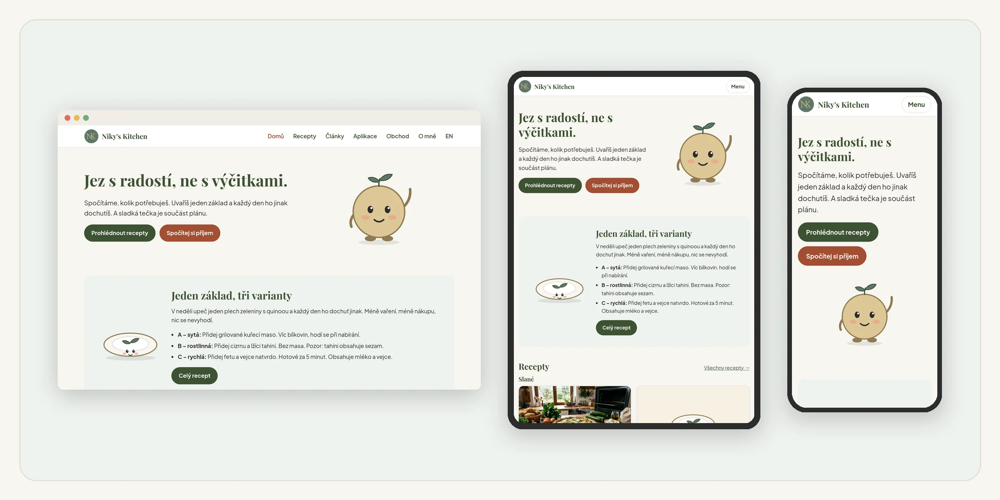
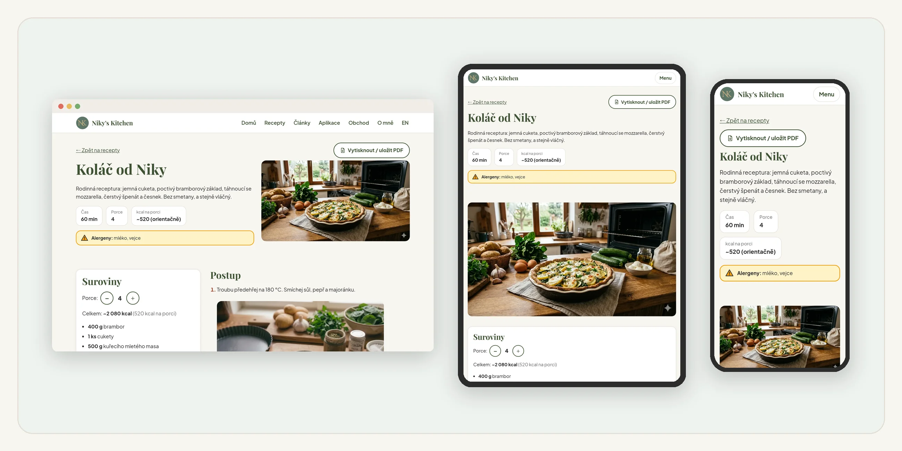
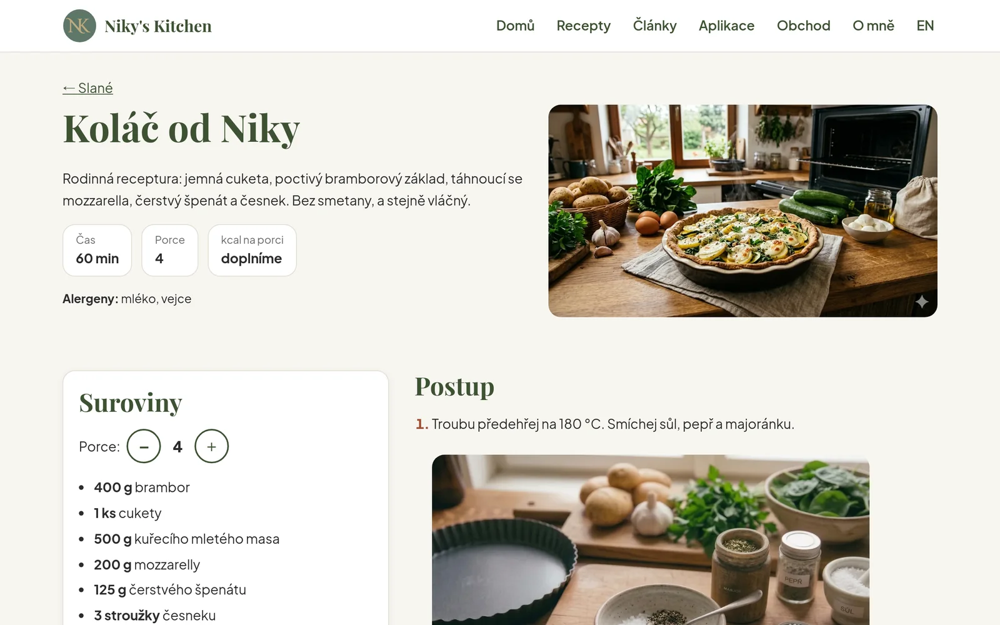
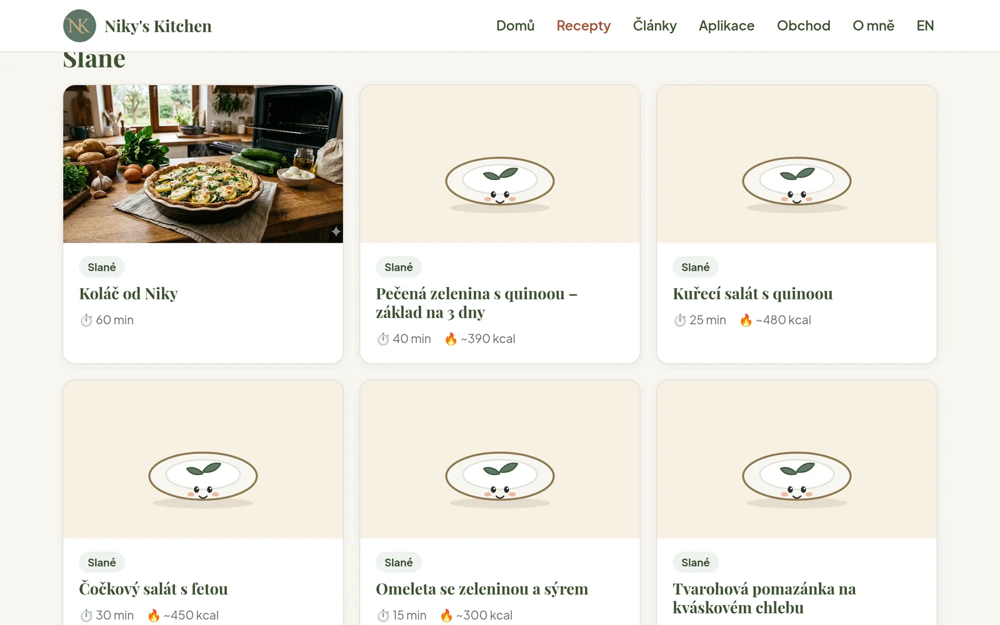
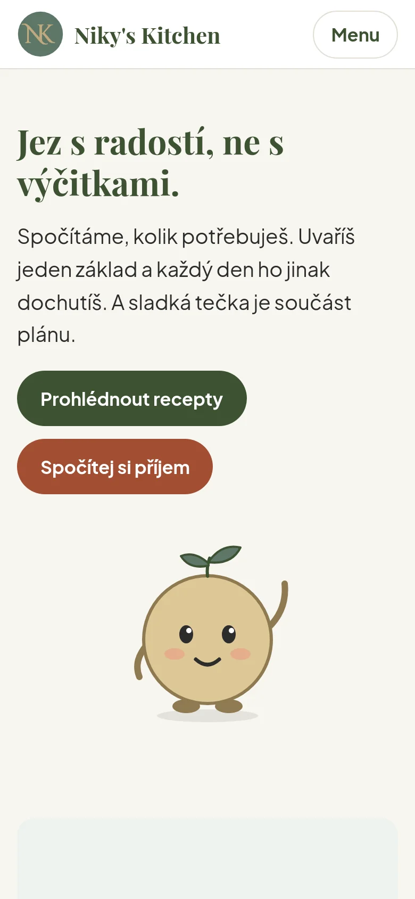
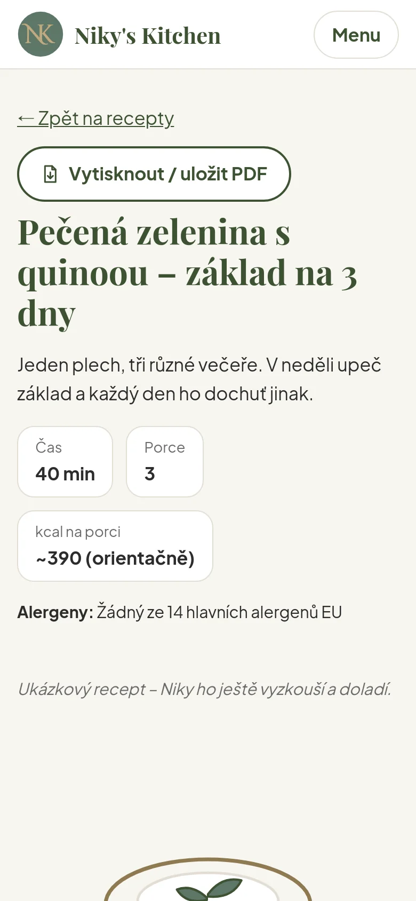
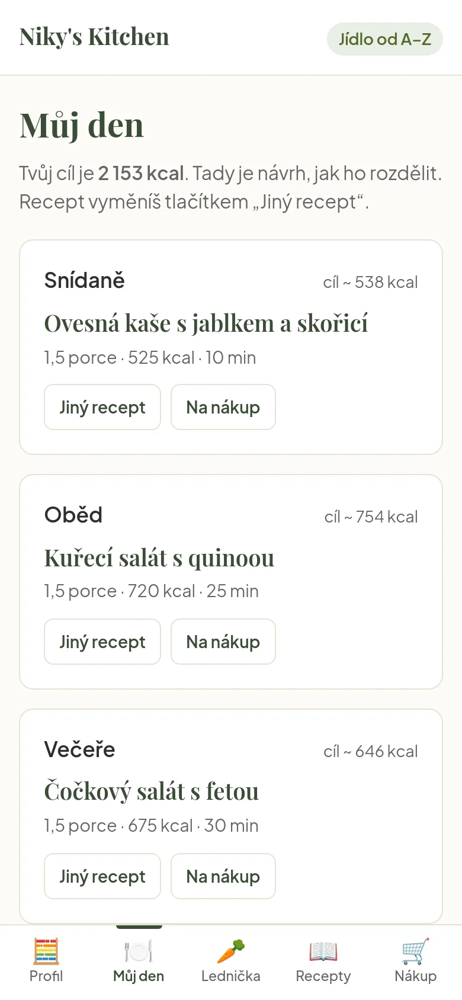
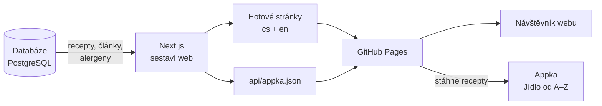
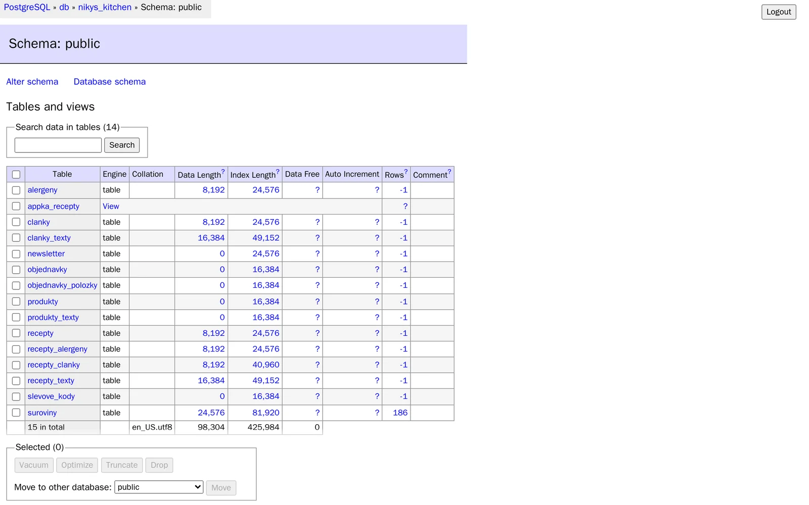
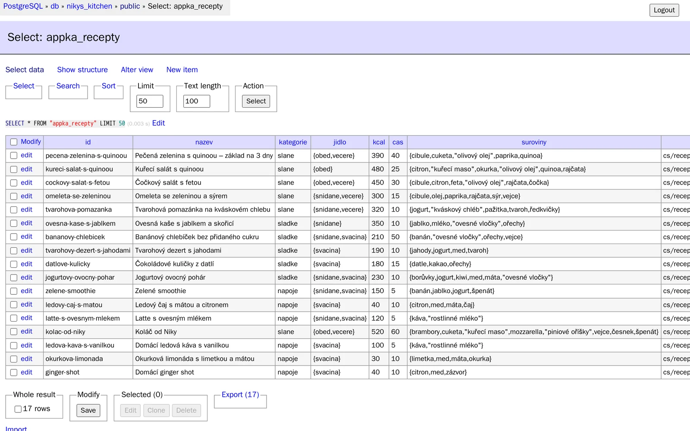

# Niky's Kitchen – web s blogem (Next.js)

**🌐 Web:** https://4613nikola-oss.github.io/nikys-kitchen-web/ · **📱 Appka:** https://4613nikola-oss.github.io/jidlo-od-a-z/

Nový web značky **Niky's Kitchen**: recepty (slané, sladké, nápoje) a krátké články o výživě, česky i anglicky. Časem tu bude i appka a obchod – všechno v jednom projektu.



**Technologie:** Next.js 16 (React 19), PostgreSQL 17, Docker, GitHub Actions + GitHub Pages, čeština a angličtina, přístupnost (WCAG).

## Jaký problém to řeší

Hodně lidí chce jíst zdravě, ale v praxi narazí na tohle:

- **Neví, kolik toho sníst.** Kalkulačka jim dá číslo v kcal, ale už neřekne, co si z toho dát k obědu.
- **Nemají čas.** Po práci nebo tréninku nechtějí složité recepty ani extra nákup.
- **Zapisování jídel je otravné.** Počítat a zapisovat každé sousto zabere čas a často vede k výčitkám, proto s tím hodně lidí brzy skončí.
- **Rady jsou roztroušené** po webech, appkách a sociálních sítích a často si odporují.

**Na co to je:** dát jednu jasnou odpověď na otázku *„co mám dnes jíst a kolik“*, a to bez zapisování a bez výčitek.

**Pro koho:** ženy i muži 18+, kteří berou zdravé jídlo jako investici do budoucna, ale nemají moc času. Chtějí zhubnout, udržet formu nebo nabrat svaly, často sportují nebo pracují na nohou.

**Čím je to jiné:**
- žádné zapisování jídel ani denní počítání, stačí jednou zadat profil,
- jeden základ receptu a tři varianty (zhubnout / udržet / nabrat), takže se pro celou rodinu vaří jednou,
- vaří se z toho, co je doma v ledničce, a nákupní seznam se sestaví sám,
- v plánu je i „sladká tečka“, protože zdravé jídlo nemá být trest,
- krátké texty s možností rozkliknout víc, čeština a angličtina, důraz na přístupnost (i pro lidi se zrakovým postižením),
- informace jen z ověřených zdrojů, bez zdravotních slibů.

## Proč se kouknout na web

- **Recepty pro lidi, kteří nemají čas.** Krátké postupy, jasné suroviny, přepočet porcí jedním klikem.
- **Jeden recept, tři varianty.** Stejný základ upravíš podle toho, jestli chceš zhubnout, udržet formu nebo nabrat, takže se nevaří zvlášť pro každého.
- **Články, které se dají přečíst za pár minut.** Nejdřív to hlavní „v kostce“, víc až po rozkliknutí, vždy s ověřenými zdroji.
- **Bez výčitek a bez zákazů.** Zdravé jídlo může být i sladké, a proto má každý plán svou „sladkou tečku“.
- **Pro co nejvíc lidí.** Čeština i angličtina, alergeny u každého receptu, přizpůsobené mobilu, s ohledem na čtečky obrazovky.
- **Navazuje na appku.** Z receptu se dostaneš rovnou do appky Jídlo od A–Z, kde si spočítáš, kolik toho sníst.

## Niky's Kitchen – jak to spolu souvisí

Niky's Kitchen má tři části. Cíl je pořád stejný: ulehčit lidem zdravé stravování bez složitého počítání a bez výčitek.

| Část | Co to je | Stav |
|------|----------|------|
| 🌐 **Web s blogem** (tento projekt) | recepty a články, každý recept má základ a varianty (zhubnout / udržet / nabrat) | online: https://4613nikola-oss.github.io/nikys-kitchen-web/ |
| 📱 **Appka Jídlo od A–Z** | kalkulačka příjmu, plán jídel, recepty z ledničky, nákupní seznam | online: https://4613nikola-oss.github.io/jidlo-od-a-z/ |
| 🛒 **Obchod** | digitální produkty: e-booky, online kuchařka, jídelní plány, kurzy | připravujeme |

**Jak na sebe navazují:** web přivede čtenáře (recept, článek, sociální sítě) → appka mu pomůže v praxi (co a kolik jíst, z čeho uvařit) → obchod nabídne placené plány a e-booky pro ty, kdo chtějí víc.

Na webu: odkazy z receptů a článků vedou do appky (stránka Aplikace) a do obchodu (stránka Obchod). Recepty a články jsou propojené mezi sebou.

## Co na webu je

- **Recepty** – 17 receptů ve třech kategoriích, přepočet porcí, alergeny (14 podle EU), varianty, tip od maskota Tečky
- **Články** – krátce „v kostce“, víc po rozkliknutí, se zdroji
- **Obchod** – 6 digitálních produktů z databáze s obálkou, cenou a ukázkou zdarma (u týdenního plánu celý den + PDF)`n- **Aplikace, O mně** – představení dalších částí
- Čeština a angličtina (`/cs/`, `/en/`), responzivní, přístupnost (WCAG), maskot Tečka

## Ukázky

**Responzivní design:** stejná stránka na počítači, tabletu i mobilu.



| Recept na počítači | Přehled receptů |
|---|---|
|  |  |

| Web v mobilu | Recept v mobilu | Appka: Můj den |
|---|---|---|
|  |  |  |

## Jak to funguje uvnitř

Recepty a články jsou uložené **jen jednou – v databázi PostgreSQL**. Web i appka si je berou odtud.



- **Při vývoji** běží databáze v Dockeru vedle webu. Obsah se dá prohlížet a upravovat v Admineru.
- **Při nasazení** si GitHub Actions spustí dočasnou databázi, nahraje do ní data z `db/init/`, sestaví web a výsledek zveřejní na GitHub Pages. Web je pak rychlý a nepotřebuje žádný server.
- **Appka** si stáhne `api/appka.json`. Když se to nepovede (bez internetu), použije záložní recepty, které má v sobě.

| Tabulky v databázi | Pohled pro appku |
|---|---|
|  |  |

**Tabulky:** `recepty`, `recepty_texty` (cs/en), `suroviny`, `alergeny` + `recepty_alergeny` (14 alergenů EU), `clanky`, `clanky_texty`, `recepty_clanky`, `newsletter`, obchod (`produkty`, `produkty_texty`, `slevove_kody`, `objednavky`, `objednavky_polozky`) a pohled `appka_recepty`.
## Spuštění

Všechno se spouští **jen v Dockeru**, nic se neinstaluje do Windows.

```
docker compose up -d                          # web → http://localhost:3000/cs/, databáze → http://localhost:8081
docker compose logs -f web                    # co se děje (Ctrl+C ukončí výpis)
docker compose restart web                    # když server nevidí nový soubor
docker compose down                           # zastavit
docker compose exec web npm run lint          # kontrola kódu
docker compose exec web npx next build        # statický web do složky out/
```

Úvodní adresa `/` přesměruje na `/cs/` až v hotovém buildu. Ve vývoji otevírej rovnou `/cs/` nebo `/en/`.

### Databáze

Při prvním spuštění zkopíruj `.env.example` jako `.env` a vymysli si heslo. Soubor `.env` se na GitHub nenahrává.

**Adminer** (http://localhost:8081): systém *PostgreSQL*, server `db`, uživatel, heslo a databáze podle `.env`.

```
docker compose exec db sh /db/zaloha.sh      # po úpravách v Admineru: uloží data do db/init/02-data.sql
docker compose down -v                       # POZOR: smaže databázi; při dalším startu se nahraje znovu z db/init/
```

Nejdřív zálohuj, pak nahraj na GitHub – jinak se úpravy z Admineru na živý web nedostanou.
## Struktura

```
app/[lang]/        stránky pro každý jazyk (cs, en)
  layout.js        společný rámec: písma, hlavička, patička
  page.js          domovská stránka
  recepty/ clanky/ aplikace/ obchod/ o-mne/
app/api/appka.json/ recepty a články pro appku (vznikne při sestavení)
db/init/           01-tabulky.sql (struktura), 02-data.sql (obsah) – nahraje se do databáze
db/zaloha.sh       záloha dat z databáze zpět do 02-data.sql
components/        Header, NavMenu, Footer, Tecka, RecipeCard, ArticleCard, PortionCalculator
dictionaries/      cs.json, en.json – texty webu (ne v kódu)
lib/               db.js (připojení k databázi), content.js (recepty a články), i18n.js, asset.js
app/globals.css    barvy, písma, rozměry jako proměnné
assets/            logo NK, maskot Tečka
public/            favicon, obrázky receptů
```

## Větve

- `dev` – rozpracované změny
- `main` – hotové a schválené

## Fáze

* **Fáze 0 (hotovo):** nastavení, Docker, struktura, jazyky, barvy a písma
* **Fáze 1 (hotovo, první verze):** recepty, články, design, maskot
* **Databáze (hotovo):** PostgreSQL v Dockeru, web i appka čtou recepty z jedné databáze
* **Dál:** doladění podle Figmy, SEO, ochrana soukromí a přístupnost, newsletter
* **Později:** appka uvnitř webu, obchod, přihlášení
